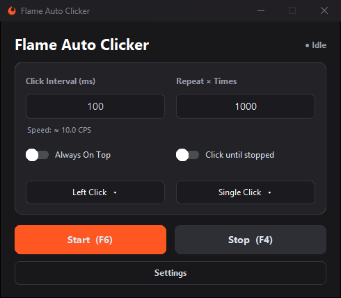
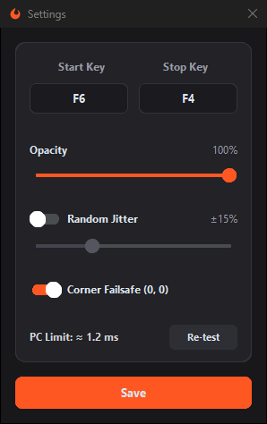

<div align="center">


# 🔥 Flame Auto Clicker `v2.0`

**Minimalist, ultra-fast, open-source Auto Clicker for Windows.**  
Completely redesigned in **v2.0** with the **Flame Dark** interface, **0% idle CPU usage**, **0 ms max-speed burst mode**, **Random Jitter**, and FPS-safe **Corner Failsafe (0, 0)**.

[](CHANGELOG.md)
[](#installation)
[](#run-from-source)
[](https://sourceforge.net/projects/flame-auto-clicker/files/latest/download)

</div>

---

## 📸 Screenshots (`v2.0`)

<div align="center">
  <table>
    <tr>
      <td align="center">
        <br />
        <sub><b>Main Window — Flame Dark UI</b></sub>
      </td>
      <td align="center">
        <br />
        <sub><b>Settings — Hotkeys, Opacity, Random Jitter & PC Limit</b></sub>
      </td>
    </tr>
  </table>
</div>

---

## ✨ What's New in `v2.0`

- 🎨 **Flame Dark UI Redesign:** Modern dark CustomTkinter interface with live CPS feedback, `● Idle` / `● Clicking` status indicator, and custom borderless dark dropdowns.
- ⚡ **Native Win32 Engine (`0%` Idle CPU):** Replaced `PySimpleGUI`, `mouse`, and `keyboard` with direct Win32 APIs (`SendInput`, `RegisterHotKey`, `GetMessageW`, `CreateMutexW`) for zero background CPU usage when paused.
- 🔥 **0 ms Burst Mode:** Set interval to `0` to send pre-built click batches for maximum CPS limited only by your PC.
- 🎲 **Random Jitter (`±1% – ±50%`):** Adds organic random variation to click intervals so your rhythm feels natural instead of robotic.
- 🛡️ **FPS-Safe Corner Failsafe `(0, 0)`:** Instantly stops clicking if your visible cursor hits the top-left corner while ignoring hidden cursors in first-person games.
- ⏱️ **Automatic PC Limit Check:** Safely measures your PC's real minimum timed interval without sending real clicks and warns you in amber if your interval is lower.
- 🪟 **Live Opacity (`10% – 100%`):** Adjust window transparency in real time without restarting.
- 💾 **Unified `config.json`:** Replaces legacy `.txt` files and restart scripts—all settings apply live and persist automatically.

---

## 🚀 Installation

### Run from Source
1. Make sure you have **Python 3.10+** installed on Windows.
2. Install the only dependency and run:
```bash
pip install -r requirements.txt
python main.py
```

---

## ⌨️ Controls

| Action | Default Key | Details |
| :--- | :---: | :--- |
| **Start Clicking** | `F6` | Click in *Settings* and press any key to rebind |
| **Stop Clicking** | `F4` | Assign the same key as Start to use it as a single toggle |
| **Emergency Stop** | Top-left `(0, 0)` | Stops clicking immediately when *Corner Failsafe* is enabled |

---

## 📋 Changelog

See [CHANGELOG.md](CHANGELOG.md) for the full **v2.0** release notes.

---

<div align="center">
  Made by <b>PETEROLO 291©</b> · Licensed under <a href="LICENSE">GPL-3.0</a>
</div>
